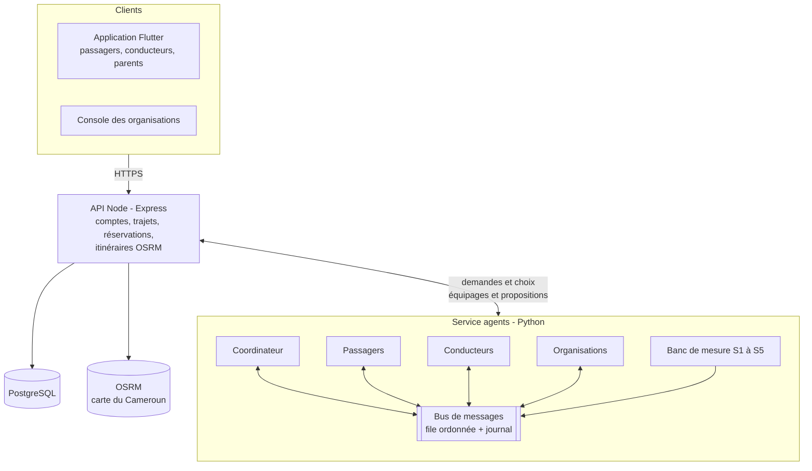
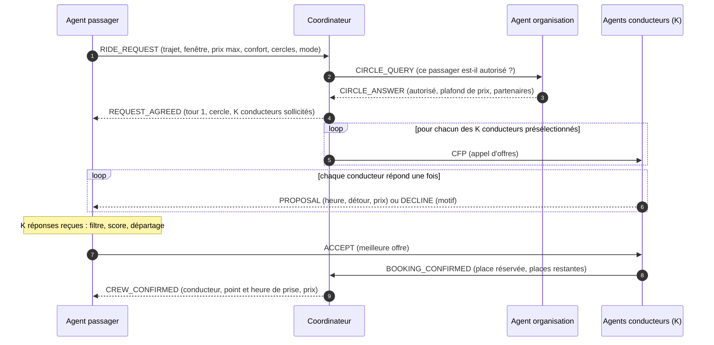
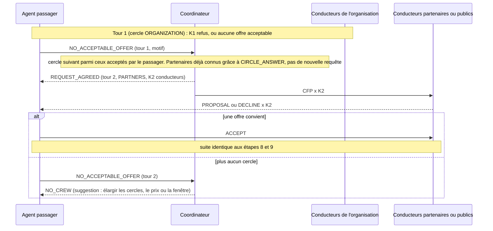
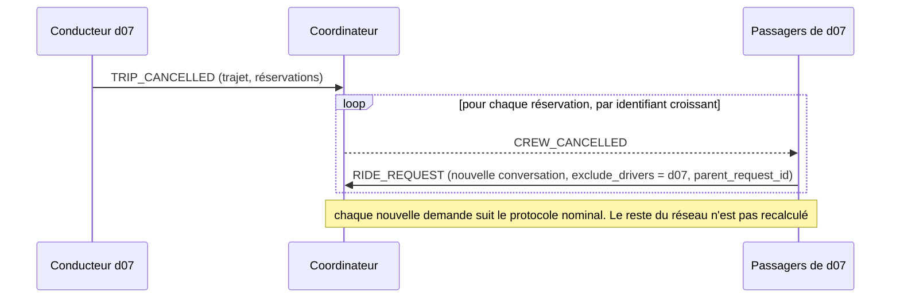
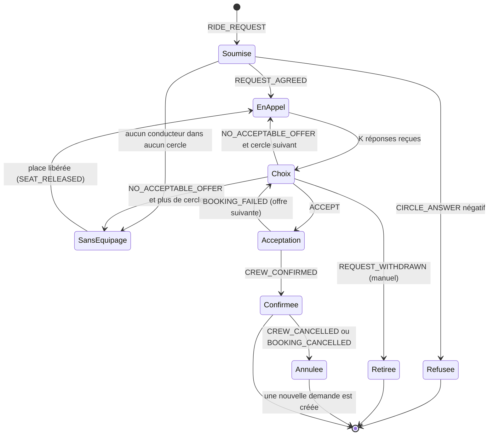

# Architecture multi-agents et protocole de négociation

> **Statut** : validé par le groupe (novembre 2026) · **Protocole** : `mboaride-cnp/1`
> **Format des messages** : [`agents/schemas/message.schema.json`](../agents/schemas/message.schema.json) · **Exemples** : [`agents/schemas/examples.json`](../agents/schemas/examples.json)
> **Références** : dossier de conception §3 à §6, document de vision §7

Ce document fixe comment les agents de MboaRide sont organisés, quels messages ils échangent et dans quel ordre. Il sert de contrat entre le moteur multi-agents (Python), l'API (Node) et le banc de mesure. Le format de chaque message est fixé par un schéma JSON vérifié par les tests (`agents/tests/test_message_schema.py`).

## En bref

1. **Quatre types d'agents** : passager, conducteur, organisation et coordinateur. Aucun ne connaît tout le réseau ; l'équipage naît de leurs messages.
2. **Un bus de messages déterministe** : les messages sont traités un par un, dans un ordre total. Aucune décision ne dépend de l'horloge ni d'un délai d'attente, donc un même scénario donne toujours le même journal de messages.
3. **Contract Net en 9 étapes**, avec **7 + 2K messages** par équipage formé au premier tour, où K est le nombre de conducteurs sollicités (5 par défaut, soit **17 messages**, sous la cible de 20).
4. **Chaque conducteur sollicité répond toujours**, par une offre ou par un refus motivé. Le passager sait donc quand il a toutes les réponses, sans attendre.
5. **Les offres n'engagent pas le conducteur** : aucune place n'est bloquée à l'offre. Le conflit (deux passagers pour une place) se règle à l'acceptation, dans l'ordre du bus.

## 1. Place du moteur dans MboaRide



- **L'API Node** reste la seule porte d'entrée des clients. Elle stocke comptes, trajets et réservations, et transmet chaque demande au service agents.
- **Le service agents** est un processus Python séparé, comme le demande le dossier de conception (« moteur séparé de l'API pour pouvoir le tester et le mesurer seul »). Le dossier `backend/app` (FastAPI) peut l'héberger.
- **Les détours** sont calculés par les agents conducteurs via une interface `RoutingService` à deux implémentations : l'API Node (`POST /routes/detours`) en conditions réelles, et un estimateur local déterministe (distances précalculées) dans les scénarios du banc, pour que les mesures ne dépendent pas du réseau.

## 2. Les agents

| Agent | Identifiant | État qu'il garde | Il décide | Il reçoit | Il envoie |
|---|---|---|---|---|---|
| **Passager** | `passenger:<id>` | sa demande, le nombre de réponses attendues, les offres reçues, le tour en cours | le classement des offres (score), l'offre acceptée (autonome) ou les 3 offres montrées (manuel) | REQUEST_AGREED, PROPOSAL, DECLINE, BOOKING_FAILED, CREW_CONFIRMED, NO_CREW, CREW_CANCELLED, ETA_UPDATED | RIDE_REQUEST, ACCEPT, NO_ACCEPTABLE_OFFER, REQUEST_WITHDRAWN, BOOKING_CANCELLED |
| **Conducteur** | `driver:<id>` | son trajet, ses places libres, son détour max, son prix plancher, ses réservations | répondre ou non à un appel d'offres, le détour, le prix ; confirmer ou refuser une acceptation | CFP, ACCEPT, BOOKING_CANCELLED | PROPOSAL, DECLINE, BOOKING_CONFIRMED, BOOKING_FAILED, TRIP_CANCELLED, DELAY_REPORTED, SEAT_RELEASED |
| **Organisation** | `organization:<id>` | ses membres, ses partenaires, son plafond de prix, ses règles (élèves de 12 ans et plus avec autorisation) | autoriser ou non un membre dans son cercle | CIRCLE_QUERY | CIRCLE_ANSWER |
| **Coordinateur** | `coordinator` | agents actifs, cercles, places libres connues, demandes ouvertes et en attente | quels conducteurs solliciter (K au plus), l'élargissement du cercle, l'ordre de traitement | RIDE_REQUEST, CIRCLE_ANSWER, BOOKING_CONFIRMED, NO_ACCEPTABLE_OFFER, REQUEST_WITHDRAWN, TRIP_CANCELLED, DELAY_REPORTED, SEAT_RELEASED | CIRCLE_QUERY, REQUEST_AGREED, CFP, CREW_CONFIRMED, NO_CREW, CREW_CANCELLED, ETA_UPDATED |

### Ce que vérifie chaque agent

Les filtres stricts du dossier de conception (§5) sont répartis ainsi :

| Filtre | Vérifié par | Motif de refus |
|---|---|---|
| Appartenance au cercle, âge ≥ 12 ans et autorisation parentale pour un élève | Agent organisation | `NOT_MEMBER`, `STUDENT_UNDER_12`, `NO_PARENTAL_CONSENT` |
| Cercle accepté par le conducteur, élèves acceptés | Agent conducteur | `CIRCLE_NOT_ACCEPTED`, `STUDENT_NOT_ALLOWED` |
| Place libre | Agent conducteur | `NO_SEAT` |
| Détour ≤ détour maximal (OSRM) | Agent conducteur | `DETOUR_TOO_LONG`, `NO_ROUTE` |
| Arrivée dans la fenêtre | Agent conducteur | `OUTSIDE_WINDOW` |
| Prix ≤ prix maximal effectif | Agent conducteur | `PRICE_TOO_HIGH` |
| Confort obligatoire | Agent conducteur | `COMFORT_MISMATCH` |
| Conducteur agréé | Coordinateur (présélection), puis l'agent conducteur | `DRIVER_NOT_APPROVED` |

L'agent passager revérifie les contraintes dures sur chaque offre reçue avant de la classer : il ne fait pas confiance aveuglément.

### Présélection par le coordinateur (le paramètre K)

Le coordinateur n'envoie pas l'appel d'offres à tous les conducteurs. Il présélectionne, avec des tests bon marché, ceux qui :

- sont agréés, ont au moins une place libre connue, n'ont pas déjà été sollicités pour cette demande et ne sont pas exclus par le passager ;
- appartiennent au cercle du tour et l'acceptent : même organisation que le passager (ORGANIZATION), organisation partenaire (PARTNERS), ou tout conducteur qui accepte le réseau public (PUBLIC) ;
- acceptent les élèves si le passager est un élève, font le même type de trajet (urbain ou interurbain) et offrent le confort obligatoire demandé ;
- déposeraient le passager dans sa fenêtre d'arrivée, à 15 minutes près : départ du conducteur + trajet jusqu'au passager + trajet partagé, estimés à vol d'oiseau × 1,3 à 20 km/h en ville (60 km/h en interurbain) ;
- ont un détour à vol d'oiseau inférieur à leur détour maximal (borne optimiste, sans appel à OSRM).

Il les trie par écart estimé croissant, puis par identifiant, et garde les **K premiers** (`cfp_fanout`, 5 par défaut). K borne directement le nombre de messages et le nombre d'appels à OSRM. Si aucun conducteur ne passe la présélection, le coordinateur passe au cercle suivant sans envoyer de message.

Sur le scénario S1, l'estimation de l'heure de dépose et le contrôle du confort ont fait passer les appels d'offres de 294 à 196 et les messages par équipage de 18 à 16,5 en moyenne (21 au plus).

## 3. Bus de messages et déterminisme

C'est la condition pour réussir le critère « 10 exécutions, 10 résultats identiques ».

1. **Une seule file, un ordre total.** Le bus attribue à chaque message un numéro `seq` croissant au moment de l'envoi, et livre les messages dans l'ordre de `seq`.
2. **Un message à la fois.** Le bus attend la fin du traitement d'un message, appel d'itinéraire compris, avant de livrer le suivant. Les agents restent des coroutines `asyncio`, mais leurs traitements ne s'entremêlent jamais.
3. **Pas d'horloge dans les décisions.** Aucune décision n'utilise l'heure réelle ni un délai d'attente. Le champ `sent_at` porte l'heure **simulée** du scénario. Le temps réel est mesuré par le banc, dans un journal à part, jamais dans les messages.
4. **Ordre d'entrée fixe.** Le scénario injecte les demandes dans l'ordre (heure de demande, identifiant du passager), comme le prévoit le dossier.
5. **Collections triées.** Toute liste parcourue (conducteurs, offres, réservations) est triée par identifiant ; pas d'itération sur un `set`.
6. **Arrondis fixés.** Distances en mètres et durées en secondes entières ; prix en FCFA entiers, arrondi au plus proche, demi vers le haut.
7. **Graine fixe** pour générer les scénarios (42 par défaut).

**Empreinte d'exécution** : SHA-256 du journal complet des messages, chaque message sérialisé en JSON à clés triées. Elle est plus stricte que l'empreinte des seules affectations prévue par le dossier : deux exécutions identiques produisent exactement les mêmes messages, dans le même ordre. L'empreinte des affectations (passager, conducteur, heure de prise) est aussi calculée, pour l'affichage.

## 4. Protocole nominal



| Étape | Message | De → vers | Performatif FIPA | Nombre |
|---|---|---|---|---|
| 1 | `RIDE_REQUEST` | passager → coordinateur | REQUEST | 1 |
| 2 | `CIRCLE_QUERY` | coordinateur → organisation | QUERY_IF | 1 (0 si le passager n'a pas d'organisation) |
| 3 | `CIRCLE_ANSWER` | organisation → coordinateur | INFORM | 1 (idem) |
| 4 | `REQUEST_AGREED` | coordinateur → passager | AGREE | 1 |
| 5 | `CFP` | coordinateur → conducteur | CFP | K |
| 6 | `PROPOSAL` ou `DECLINE` | conducteur → passager | PROPOSE / REFUSE | K |
| 7 | `ACCEPT` | passager → conducteur | ACCEPT_PROPOSAL | 1 |
| 8 | `BOOKING_CONFIRMED` | conducteur → coordinateur | CONFIRM | 1 |
| 9 | `CREW_CONFIRMED` | coordinateur → passager | INFORM | 1 |
| | **Total** | | | **7 + 2K** |

### Classement des offres par l'agent passager

Le passager calcule le score du dossier de conception pour chaque offre :

S = 0,30 (1 − d/d_max) + 0,25 (1 − |t − t_cible| / Δt) + 0,25 (1 − p/p_max) + 0,10 c + 0,10 k

avec `d = detour_m`, `d_max = max_detour_m`, `t = dropoff_time`, `t_cible` et `Δt` (demi-largeur) tirés de `arrival_window`, `p = price`, `p_max = max_price`, `c` la part des critères de confort souhaités présents dans `comfort_offered`, et `k` = 1 (ORGANIZATION), 0,5 (PARTNERS) ou 0 (PUBLIC). Les poids peuvent être remplacés par `weights` dans la demande.

**À score égal** : le plus petit détour, puis le départ le plus tôt (`departure_time`), puis le plus petit identifiant de conducteur.

Implémentation : `agents/mboaride_agents/passenger.py`. Le score est calculé en fractions exactes, pour que deux offres équivalentes soient à égalité stricte et que le départage s'applique toujours de la même façon. Chaque terme est borné entre 0 et 1 (une heure visée décentrée dans la fenêtre ne donne pas de terme négatif). Sans confort souhaité, le terme confort vaut 1 pour toutes les offres. Avant le score, le passager écarte les offres contraires à ses exigences, avec un motif interne qui n'est pas envoyé sur le bus : `PRICE_TOO_HIGH`, `OUTSIDE_WINDOW`, `COMFORT_MISSING`, `CIRCLE_NOT_ACCEPTED`, `EXCLUDED_DRIVER`, `DETOUR_ABOVE_MAX`.

Exemple tiré de [`examples.json`](../agents/schemas/examples.json), pour Grâce (Kotto → Bonanjo, arrivée visée 7 h 40 ± 10 min, 300 FCFA au plus, climatisation souhaitée) :

| Offre | Détour | Arrivée | Prix | Confort | Score |
|---|---|---|---|---|---|
| d07 | 1 400 / 3 000 m | 7 h 36 | 165 FCFA | climatisation | **0,62** (retenue) |
| d03 | 2 600 / 3 000 m | 7 h 44 | 228 FCFA | non | 0,35 |
| d12 | refus `DETOUR_TOO_LONG` | | | | |

### Calcul du prix porté par l'offre

Le conducteur calcule le prix et en détaille le calcul dans `price_breakdown`, ce qui permet de changer la règle sans changer le format :

- `fuel_cost` = distance partagée (km) × consommation (L/km) × prix du litre (840 FCFA), arrondi ;
- `tolls` = péages (trajets interurbains) ;
- `divisor` = nombre de parts : occupants selon le dossier de conception, places offertes dans la version mesurée par le bilan durable. **C'est le point ouvert du bilan (le conducteur ne couvre que 39 % de ses frais)** ; le format accepte les deux règles ;
- `commission` = 10 % de la part, en réseau public et en interurbain, 0 sinon ;
- `price` = max(arrondi((`fuel_cost` + `tolls`) / `divisor`), prix plancher du conducteur) + `commission`.

Implémentation : `agents/mboaride_agents/pricing.py`. Les calculs se font en fractions exactes, arrondies au FCFA, demi vers le haut. La règle du diviseur se choisit avec `PricingPolicy(divisor_rule=...)` : `OFFERED_SEATS` (conducteur + places offertes, par défaut) ou `OCCUPANTS` (conducteur + passagers à bord).

## 5. Variantes et imprévus

### 5.1 Élargissement des cercles



- Le coordinateur ne consulte l'organisation **qu'une fois par demande** : `CIRCLE_ANSWER` donne déjà la liste des partenaires, et le réseau public n'a pas d'agent organisation.
- Un conducteur déjà sollicité n'est pas sollicité à nouveau dans un tour suivant.
- Coût d'un tour supplémentaire : 1 (NO_ACCEPTABLE_OFFER) + 1 (REQUEST_AGREED) + 2K messages.
- Si l'organisation refuse le passager (par exemple un élève de moins de 12 ans), le coordinateur répond directement `NO_CREW` avec `reason = REFUSED_BY_ORGANIZATION` : 4 messages, sans appel d'offres.

### 5.2 Place prise entre l'offre et l'acceptation

Les offres n'engagent pas le conducteur. Si deux passagers acceptent la même dernière place, le bus traite les acceptations dans l'ordre de `seq` : la première est confirmée, la seconde reçoit `BOOKING_FAILED (SEAT_TAKEN)`. Le passager essaie alors l'offre suivante de son classement, sans nouvel appel d'offres (+2 messages par échec). S'il n'en reste aucune, il envoie `NO_ACCEPTABLE_OFFER (ALL_FAILED)` et le coordinateur passe au tour suivant.

### 5.3 Mode manuel

Le protocole est identique ; seule l'étape 7 change. Après les K réponses, l'agent passager transmet les 3 meilleures offres à l'utilisateur, par l'API et hors du bus. Le choix de l'utilisateur produit :

- `ACCEPT` sur l'offre choisie ;
- `NO_ACCEPTABLE_OFFER (USER_ASKED_WIDENING)` s'il demande à élargir ;
- `REQUEST_WITHDRAWN (USER_DECLINED_ALL)` s'il refuse tout.

Dans le scénario S5, le choix humain est simulé de façon déterministe (le scénario indique quel rang l'utilisateur choisit). Le temps de réflexion humain est **exclu** de la mesure de convergence.

### 5.4 Annulation d'un conducteur



### 5.5 Retard signalé

`DELAY_REPORTED` (conducteur → coordinateur) donne les nouvelles heures pour chaque réservation. Le coordinateur envoie `ETA_UPDATED` à chaque passager concerné, avec `within_window`. Si l'arrivée sort de sa fenêtre, l'agent passager envoie `BOOKING_CANCELLED (ETA_OUT_OF_WINDOW)` au conducteur, puis une nouvelle `RIDE_REQUEST` qui exclut ce conducteur.

### 5.6 Annulation d'un passager et place libérée

`BOOKING_CANCELLED` (passager → conducteur), puis `SEAT_RELEASED` (conducteur → coordinateur). Le coordinateur reprend alors la plus ancienne demande en attente (terminée par `NO_CREW` et dont la fenêtre n'est pas passée) compatible avec ce conducteur, et lui envoie un nouvel appel d'offres, dans un nouveau tour de cette conversation.

### 5.7 Cycle de vie d'une demande



## 6. Format des messages

### 6.1 Enveloppe commune

Tous les messages ont exactement ces champs, et aucun autre (le schéma refuse les champs inconnus) :

| Champ | Type | Rôle |
|---|---|---|
| `protocol` | `"mboaride-cnp/1"` | version du protocole ; tout changement incompatible crée `/2` |
| `id` | texte | identifiant unique du message (`m-<seq>` dans le banc) |
| `seq` | entier ≥ 1 | ordre total attribué par le bus |
| `conversation_id` | texte | une conversation par demande (`r-<passager>-<n>`) ou par trajet de conducteur (`t-<conducteur>`) |
| `in_reply_to` | texte ou `null` | message dont le traitement a provoqué celui-ci ; `null` pour un message spontané |
| `type` | une des 20 valeurs du catalogue | décide du corps attendu |
| `performative` | performatif FIPA-ACL | fixé par le type |
| `sender`, `receiver` | `coordinator`, `passenger:<id>`, `driver:<id>`, `organization:<id>` | le rôle est fixé par le type (un `PROPOSAL` vient toujours d'un conducteur) |
| `sent_at` | date ISO 8601 avec fuseau | heure **simulée** du scénario |
| `body` | objet | corps propre au type, champs fixés par le schéma |

### 6.2 Conventions

- **Unités** : distances en mètres (`*_m`), durées en secondes (`*_s`), montants en FCFA, tous en **entiers**. Les noms suivent ceux de l'API Node (`detour_m`, `detour_s`, `shared_distance_m`).
- **Points** : `{ "lat": …, "lng": … }`, comme l'API Node.
- **Heures** : ISO 8601 à la seconde, avec fuseau (`2026-11-10T07:40:00+01:00`).
- **Noms** : champs en `snake_case`, valeurs d'énumération en `MAJUSCULES`.
- **Minimisation des données** (loi n° 2024/017) : aucun nom, téléphone ni email dans les messages ; un élève n'est décrit que par son âge et l'autorisation parentale ; l'appel d'offres ne dit pas qui est le passager, seulement à quel agent répondre.

### 6.3 Catalogue

| # | Type | Performatif | De → vers | Contenu principal du corps |
|---|---|---|---|---|
| 1 | `RIDE_REQUEST` | REQUEST | passager → coordinateur | départ, arrivée, fenêtre, prix max, places, confort, cercles, mode, conducteurs exclus |
| 2 | `CIRCLE_QUERY` | QUERY_IF | coordinateur → organisation | passager, adulte ou élève (âge, autorisation) |
| 3 | `CIRCLE_ANSWER` | INFORM | organisation → coordinateur | autorisé, motif, plafond de prix, partenaires |
| 4 | `REQUEST_AGREED` | AGREE | coordinateur → passager | tour, cercle, conducteurs sollicités, réponses attendues |
| 5 | `CFP` | CFP | coordinateur → conducteur | tour, cercle, agent à qui répondre, trajet, fenêtre, prix max effectif, confort obligatoire |
| 6 | `PROPOSAL` | PROPOSE | conducteur → passager | offre, heures, point de prise, détour, détour max, distance partagée, prix détaillé, confort |
| 7 | `DECLINE` | REFUSE | conducteur → passager | tour, motif |
| 8 | `ACCEPT` | ACCEPT_PROPOSAL | passager → conducteur | offre, tour |
| 9 | `BOOKING_CONFIRMED` | CONFIRM | conducteur → coordinateur | réservation, passager, prix, point de prise (optionnel, ajouté en 1.1), heures, places restantes |
| 10 | `BOOKING_FAILED` | FAILURE | conducteur → passager | offre, motif (`SEAT_TAKEN`…) |
| 11 | `CREW_CONFIRMED` | INFORM | coordinateur → passager | réservation, conducteur, point et heures, prix, nombre de tours |
| 12 | `NO_ACCEPTABLE_OFFER` | INFORM | passager → coordinateur | tour, motif |
| 13 | `NO_CREW` | FAILURE | coordinateur → passager | tours essayés, motif, suggestion |
| 14 | `REQUEST_WITHDRAWN` | CANCEL | passager → coordinateur | motif |
| 15 | `TRIP_CANCELLED` | CANCEL | conducteur → coordinateur | trajet, réservations, motif |
| 16 | `CREW_CANCELLED` | INFORM | coordinateur → passager | réservation, conducteur, motif |
| 17 | `DELAY_REPORTED` | INFORM | conducteur → coordinateur | trajet, retard, nouvelles heures par réservation |
| 18 | `ETA_UPDATED` | INFORM | coordinateur → passager | réservation, nouvelles heures, encore dans la fenêtre ? |
| 19 | `BOOKING_CANCELLED` | CANCEL | passager → conducteur | réservation, motif |
| 20 | `SEAT_RELEASED` | INFORM | conducteur → coordinateur | trajet, réservation, places restantes |

Le détail des champs, des types et des valeurs possibles est dans le schéma. Exemple d'offre :

```json
{
  "protocol": "mboaride-cnp/1", "id": "m-8", "seq": 8, "conversation_id": "r-p042-1", "in_reply_to": "m-5",
  "type": "PROPOSAL", "performative": "PROPOSE", "sender": "driver:d07", "receiver": "passenger:p042",
  "sent_at": "2026-11-10T06:15:00+01:00",
  "body": {
    "offer_id": "o-d07-r-p042-1", "round": 1, "circle": "ORGANIZATION",
    "departure_time": "2026-11-10T06:55:00+01:00",
    "pickup_point": { "lat": 4.0711, "lng": 9.759 },
    "pickup_time": "2026-11-10T07:08:00+01:00", "dropoff_time": "2026-11-10T07:36:00+01:00",
    "detour_m": 1400, "detour_s": 240, "max_detour_m": 3000, "shared_distance_m": 9800,
    "price": 165, "price_breakdown": { "fuel_cost": 659, "tolls": 0, "divisor": 4, "commission": 0 },
    "comfort_offered": ["AIR_CONDITIONING", "NON_SMOKING"]
  }
}
```

### 6.4 Faire évoluer le format

1. Modifier `message.schema.json`, puis `examples.json`, puis ce document, dans la même PR.
2. Ajouter un champ **optionnel** reste compatible (`/1`). Supprimer ou renommer un champ, ou le rendre obligatoire, crée `mboaride-cnp/2`.
3. `pytest` dans `agents/` doit rester vert.

L'API Node peut valider les mêmes messages avec ce schéma (par exemple avec `ajv`), ce qui évite deux définitions divergentes.

## 7. Budget de messages et mesures

| Situation | Messages | Avec K = 5 |
|---|---|---|
| Équipage formé au 1er tour, passager membre d'une organisation | 7 + 2K | **17** |
| Équipage formé au 1er tour, réseau public uniquement (pas d'organisation) | 5 + 2K | 15 |
| Chaque acceptation refusée (`SEAT_TAKEN`) | +2 | |
| Chaque tour supplémentaire (élargissement) | +2 + 2K | +12 |
| Refus de l'organisation | 4 | 4 |
| Annulation d'un conducteur avec n passagers | 1 + n + n × (nouvelle négociation) | |

La cible « moins de 20 messages par équipage » est tenue au premier tour avec K ≤ 6. Elle se mesure **en moyenne** sur un scénario : les demandes qui demandent un élargissement la dépassent, celles du réseau public restent en dessous. Si la moyenne de S2 dépasse 20, on baisse K pour les tours 2 et 3.

Ce que mesure le banc, à partir du journal du bus :

| Critère de la grille | Mesure |
|---|---|
| Convergence | temps réel entre le premier `RIDE_REQUEST` et le dernier message final (`CREW_CONFIRMED`, `NO_CREW` ou `REQUEST_WITHDRAWN`) ; nombre de tours par équipage (pour la lecture « nombre de cycles » de la grille) |
| Charge de communication | messages au total, par type, et par équipage formé (messages des conversations terminées par `CREW_CONFIRMED` / nombre d'équipages) |
| Déterminisme | empreinte SHA-256 du journal sur 10 exécutions : 10 empreintes identiques attendues |
| Mémoire | pic `tracemalloc` du moteur, comparé entre la 1re et la 10e exécution |

Les motifs de refus (`DECLINE.reason`, `NO_CREW.reason`) alimentent aussi le bilan durable, par exemple pour expliquer pourquoi seuls 14 élèves sur 30 trouvent un équipage dans S2.

## 7 bis. Implémentation

| Module (`agents/mboaride_agents/`) | Rôle |
|---|---|
| `bus.py` | bus de messages déterministe : file unique, `seq`, journal, empreinte SHA-256 |
| `coordinator.py` | agent coordinateur : présélection des K conducteurs, tours d'appel d'offres, élargissement des cercles, confirmation de l'équipage |
| `organization.py` | agent organisation : membres, élèves de 12 ans et plus avec autorisation, plafond de prix, partenaires |
| `driver.py` | agent conducteur : offre ou refus, puis réservation ou `SEAT_TAKEN` à l'acceptation |
| `passenger.py` | agent passager : classement des offres, modes autonome et manuel |
| `engine.py` | moteur : inscription des agents, soumission des demandes, actions de l'utilisateur en mode manuel, mesures |
| `scenarios.py` | scénarios simulés à graine fixe (S1 pour l'instant) |

Mesures actuelles sur S1 (graine 42, 20 conducteurs, 50 passagers) : 30 équipages, 16,5 messages par équipage (21 au plus), environ 20 ms de traitement, même empreinte sur 10 exécutions.

## 8. Interface avec l'API Node (proposition, à définir avec le backend)

| Route du service agents | Appelée par | Rôle |
|---|---|---|
| `POST /negotiations` | API Node | soumet une demande (corps de `RIDE_REQUEST` + identifiant du passager) ; renvoie l'équipage, `NO_CREW`, ou en mode manuel les 3 offres et l'identifiant de conversation |
| `POST /negotiations/{id}/choice` | API Node | choix de l'utilisateur en mode manuel : `offer_id`, `widen` ou `cancel` |
| `POST /trips/{id}/events` | API Node | annulation ou retard d'un conducteur, annulation d'un passager |
| `GET /negotiations/{id}/messages` | API Node, console | journal des messages d'une conversation (démonstration, US15) |
| `POST /bench/runs` | banc, démonstrateur | lance un scénario S1 à S5 et renvoie les quatre mesures |

L'état des conducteurs (trajets, places, agrément) vient de la base de l'API Node ; le service agents en garde une copie en mémoire pendant la négociation.

## 9. Écarts avec le dossier de conception, validés par le groupe

| # | Point | Dossier de conception | Décision retenue | Pourquoi |
|---|---|---|---|---|
| 1 | Accusé de réception | 8 étapes | ajout de `REQUEST_AGREED` (9 étapes) | le passager sait combien de réponses attendre, sans délai d'attente ; l'application peut afficher « recherche dans votre entreprise » |
| 2 | Conducteur incompatible | ne répond pas | répond `DECLINE` avec un motif | pas de délai d'attente, donc déterministe ; les motifs expliquent les échecs |
| 3 | Nombre de conducteurs sollicités | « les compatibles » | K au plus (5 par défaut) | borne les messages (7 + 2K) et les appels à OSRM |
| 4 | Engagement de l'offre | non précisé | offre non engageante, conflit réglé à l'acceptation | pas de place bloquée inutilement, pas de message de rejet à envoyer aux offres perdantes |
| 5 | Requête à l'organisation | à chaque élargissement | une seule fois par demande | la réponse contient déjà les partenaires |
| 6 | Départage | détour, départ, identifiant | identique | le squelette actuel (`agents.py`) classe par prix : il sera aligné sur le dossier |
| 7 | Nom du premier cercle | « entreprise » | `ORGANIZATION` | couvre aussi les écoles et les campus |
| 8 | Unité du détour | km | mètres et secondes | mêmes unités que l'API Node et OSRM |

**Points encore ouverts :**

- **Valeur de K** : 5 par défaut, à ajuster avec les mesures de S1 et S2.
- **Règle de partage du prix** (`divisor`) : point ouvert du bilan durable ; le format ne change pas, quelle que soit la décision.
- **Zone de service** : l'API Node refuse aujourd'hui les points hors de Douala ; il faudra l'élargir pour le scénario interurbain S4 (Douala-Yaoundé).
- **« Moins de 2 cycles »** dans la grille : temps réel ou nombre de tours ; le banc mesure les deux, à confirmer avec l'encadrant.
