# MboaRide · Diagrammes UML (Mermaid et PlantUML)

Diagrammes de conception de MboaRide, tirés du code réel : schéma PostgreSQL
(`backend/sql/01` à `10`), API Python (`backend/app`), API Node (authentification),
moteur multi-agents (`agents/mboaride_agents`) et application Flutter.

Les diagrammes sont en noir et blanc (thème Mermaid `neutral`), sauf les diagrammes de
séquence. Les diagrammes de cas d'utilisation (partie 5) sont en PlantUML, pour dessiner
les acteurs en bonhommes. Chaque bloc `mermaid` s'affiche directement sur GitHub, dans VS Code (extension
« Markdown Preview Mermaid Support ») ou sur https://mermaid.live (copier le contenu du
bloc, sans les lignes ```` ``` ````).

Sommaire :

1. [Modèle conceptuel de données (MCD)](#1-modèle-conceptuel-de-données-mcd)
2. [Diagrammes d'activité](#2-diagrammes-dactivité)
3. [Diagrammes de séquence](#3-diagrammes-de-séquence)
4. [Diagrammes de classes](#4-diagrammes-de-classes)
5. [Diagrammes de cas d'utilisation (PlantUML)](#5-diagrammes-de-cas-dutilisation)

---

## 1. Modèle conceptuel de données (MCD)

Entités et associations de la base `mboaride`, avec leurs cardinalités. Les associations
porteuses de données (appartenance, partenariat) sont représentées comme des entités
associatives. Notation : `||` exactement un, `o|` zéro ou un, `o{` zéro ou plusieurs.

```mermaid
%%{init: {"theme": "neutral"}}%%
erDiagram
    ORGANISATION {
        int id_organisation PK
        string nom
        string type_organisation "entreprise, etablissement_scolaire, campus, evenement"
        string ville
        string domaine_email UK
        string code_invitation UK
        boolean abonnement_actif
        int effectif
        decimal objectif_adoption
    }
    PARTENARIAT {
        int id_organisation_a PK, FK
        int id_organisation_b PK, FK
        date depuis_le
    }
    UTILISATEUR {
        int id_utilisateur PK
        string nom
        string prenom
        string telephone UK
        string email UK
        boolean est_conducteur
        string statut_agrement "non_demande, en_verification, actif, suspendu"
        string mode_reservation "autonome, manuel"
        string priorite "heure, prix"
        boolean accepte_collegues
        boolean accepte_partenaires
        boolean accepte_public
        boolean accepte_eleves
        int prix_min_fcfa
        int prix_max_defaut_fcfa
    }
    APPARTENANCE {
        int id_utilisateur PK, FK
        int id_organisation PK, FK
        string role "membre, administrateur"
        string service
        date date_adhesion
    }
    INVITATION {
        int id_invitation PK
        string email
        string jeton UK
        string statut "envoyee, acceptee, expiree, annulee"
        int relances
        datetime expire_le
    }
    COMPTE_NODE {
        int id_compte_node PK "users.id de l'API Node"
        int id_utilisateur FK, UK
        string lie_par "email, telephone, creation, manuel"
    }
    DOCUMENT_AGREMENT {
        int id_document PK
        string type_document "piece_identite, permis, casier_judiciaire, assurance"
        string statut "depose, valide, refuse, expire"
        date expire_le
    }
    VEHICULE {
        int id_vehicule PK
        string marque_modele
        string immatriculation UK
        int places_passagers
        decimal conso_l_100km
        boolean climatise
        boolean non_fumeur
    }
    COMPTE_ELEVE {
        int id_eleve PK
        string prenom
        int age_declare "12 à 17 ans"
        boolean autorisation_active
    }
    TRAJET {
        int id_trajet PK
        string type_trajet "urbain, interurbain"
        string depart_libelle
        string arrivee_libelle
        time heure_depart
        date date_unique "trajet ponctuel"
        string jours_semaine "trajet régulier, ex. 1111100"
        int places_offertes
        decimal detour_max_km
        int peage_fcfa
        string point_ramassage
        string consignes_ramassage
        int attente_max_min
        string statut "actif, annule, termine"
    }
    POINT_DEPART {
        int id_point PK
        int ordre_passage
        string libelle
        time heure_passage
    }
    INDISPONIBILITE_TRAJET {
        int id_trajet PK, FK
        date date_trajet PK
        string motif
    }
    DEMANDE {
        int id_demande PK
        string depart_libelle
        string arrivee_libelle
        time arrivee_au_plus_tot
        time arrivee_au_plus_tard
        date date_unique
        int prix_max_fcfa
        boolean clim_obligatoire
        string cercle_max "organisation, partenaires, public"
        string statut "ouverte, satisfaite, sans_equipage, annulee"
    }
    RESERVATION {
        int id_reservation PK
        date date_trajet
        time heure_prise_en_charge
        time heure_arrivee_estimee
        int prix_fcfa
        decimal detour_km
        string niveau_cercle
        string statut "confirmee, annulee, terminee"
        datetime fin_validee_le
    }
    PAIEMENT {
        int id_paiement PK
        int montant_fcfa
        int commission_fcfa "10 % du prix"
        string moyen "mobile_money, especes, portefeuille"
        string operateur "mtn, orange"
        string reference_transaction UK
        string statut "en_attente, reussi, echoue, rembourse"
        int tentatives "3 au plus"
        datetime verse_le "versé au conducteur"
        int montant_verse_fcfa
    }
    COMMISSION_MBOARIDE {
        int id_paiement PK, FK
        int montant_fcfa
        datetime preleve_le
    }
    EVALUATION {
        int id_evaluation PK
        int note "1 à 5"
        string commentaire
        boolean signalement_grave
    }
    COURSE {
        int id_trajet PK, FK
        date date_trajet PK
        string statut "en_cours, arrivee, reglee"
        datetime demarree_le
        datetime arrivee_le
        datetime reglee_le
    }
    COMPTE_MOBILE_MONEY {
        int id_compte PK
        string operateur "mtn, orange"
        string telephone
        string titulaire
        boolean par_defaut
    }
    PORTEFEUILLE {
        int id_utilisateur PK, FK
        int solde_fcfa "jamais négatif"
        boolean virement_auto
    }
    MOUVEMENT_PORTEFEUILLE {
        int id_mouvement PK
        string type "recharge, paiement, remboursement, gain, retrait"
        int montant_fcfa
        int solde_apres_fcfa
        string libelle
        string reference
    }
    NOTIFICATION {
        int id_notification PK
        string type "retard, annulation, course, fin_course, paiement, versement..."
        string message
        boolean lue
    }

    ORGANISATION ||--o{ APPARTENANCE : "regroupe"
    UTILISATEUR ||--o{ APPARTENANCE : "adhère à"
    ORGANISATION ||--o{ PARTENARIAT : "est partenaire (côté A)"
    ORGANISATION ||--o{ PARTENARIAT : "est partenaire (côté B)"
    ORGANISATION ||--o{ INVITATION : "envoie"
    UTILISATEUR ||--o{ INVITATION : "invite"
    UTILISATEUR |o--o{ INVITATION : "accepte"
    UTILISATEUR ||--o| COMPTE_NODE : "est authentifié par"
    UTILISATEUR ||--o{ DOCUMENT_AGREMENT : "dépose"
    UTILISATEUR ||--o{ VEHICULE : "possède"
    UTILISATEUR ||--o{ COMPTE_ELEVE : "est parent de"
    ORGANISATION |o--o{ COMPTE_ELEVE : "scolarise"
    UTILISATEUR ||--o{ TRAJET : "conduit"
    VEHICULE ||--o{ TRAJET : "est utilisé pour"
    TRAJET ||--o{ POINT_DEPART : "passe par"
    TRAJET ||--o{ INDISPONIBILITE_TRAJET : "est annulé le"
    UTILISATEUR ||--o{ DEMANDE : "formule"
    COMPTE_ELEVE |o--o{ DEMANDE : "concerne"
    ORGANISATION |o--o{ DEMANDE : "est rattachée à"
    DEMANDE ||--o{ RESERVATION : "aboutit à"
    TRAJET ||--o{ RESERVATION : "accueille"
    RESERVATION ||--o| PAIEMENT : "est réglée par"
    PAIEMENT ||--o| COMMISSION_MBOARIDE : "rapporte"
    RESERVATION ||--o{ EVALUATION : "est évaluée par"
    UTILISATEUR ||--o{ EVALUATION : "rédige"
    UTILISATEUR ||--o{ EVALUATION : "reçoit"
    TRAJET ||--o{ COURSE : "se déroule en"
    UTILISATEUR ||--o{ COMPTE_MOBILE_MONEY : "enregistre"
    UTILISATEUR ||--o| PORTEFEUILLE : "détient"
    PORTEFEUILLE ||--o{ MOUVEMENT_PORTEFEUILLE : "enregistre"
    RESERVATION |o--o{ MOUVEMENT_PORTEFEUILLE : "justifie"
    UTILISATEUR ||--o{ NOTIFICATION : "reçoit"
    RESERVATION |o--o{ NOTIFICATION : "concerne"
    COMPTE_ELEVE |o--o{ NOTIFICATION : "concerne"
```

Règles de gestion portées par la base (déclencheurs et contraintes) :

- RG1 : seul un conducteur à l'agrément actif publie un trajet ;
- RG2 : un trajet n'a pas plus de réservations confirmées que de places, pour une date donnée ;
- RG3 : un élève ne voyage que si son autorisation parentale est active ;
- RG4 : un signalement grave suspend l'agrément du conducteur évalué ;
- RG5 : une demande n'a qu'une réservation confirmée par date ;
- RG6 : un portefeuille n'est jamais négatif ; un paiement n'est versé au conducteur que s'il est réussi.

---

## 2. Diagrammes d'activité

Mermaid n'a pas de diagramme d'activité dédié : ils sont tracés en organigramme, avec un
couloir (sous-graphe) par acteur. Le cercle plein marque le début, le double cercle la fin,
les losanges les décisions.

### 2.1 Parcours complet d'un trajet partagé

De la publication par le conducteur au versement de son paiement.

```mermaid
%%{init: {"theme": "neutral"}}%%
flowchart TD
    debut((" ")) --> C1

    subgraph COND["Conducteur"]
        C1["Faire valider son agrément<br/>(4 pièces)"] --> C2["Enregistrer son véhicule"]
        C2 --> C3["Publier un trajet<br/>(jours, heure, places, détour,<br/>point de ramassage)"]
        C9["Démarrer la course"]
        C10["Prendre les passagers<br/>au point de ramassage"]
        C11["Déclarer l'arrivée"]
    end

    subgraph PASS["Passager"]
        P1["Se connecter"] --> P2["Demander un trajet<br/>(départ, arrivée, date,<br/>fenêtre d'arrivée, prix max, cercle)"]
        P3["Choisir une offre<br/>et confirmer le prix"]
        P4["Élargir le cercle, le budget<br/>ou la fenêtre"]
        P5["Payer<br/>(portefeuille ou Mobile Money)"]
        P6["Renoncer au trajet"]
        P7["Suivre la course sur la carte<br/>(GPS ou simulation)"]
        P8["Valider la fin de la course,<br/>noter et commenter"]
    end

    subgraph SYS["Système MboaRide (API et moteur d'agents)"]
        S1["Enregistrer la demande"] --> S2["Calculer les offres :<br/>cercle, jour, places, détour,<br/>horaires, prix"]
        S2 --> D1{"Offre<br/>confirmable ?"}
        D1 -->|non| S3["Diagnostic et suggestions"]
        D2{"Prix inchangé<br/>depuis l'affichage ?"}
        S4["Retenir la place<br/>et ouvrir un paiement en attente"]
        D3{"Paiement<br/>réussi ?"}
        D4{"Moins de<br/>3 tentatives ?"}
        S5["Libérer la place,<br/>rouvrir la demande"]
        S6["Ajouter le passager à l'équipage,<br/>prévenir le conducteur"]
        S7["Prévenir les passagers"]
        D5{"Arrivé à moins<br/>de 80 m ?"}
        D6{"Tous les passagers<br/>ont validé ?"}
        S8["Valider d'office<br/>après 24 h"]
        S9["Verser au portefeuille du conducteur<br/>le prix moins 10 % de commission"]
        D7{"Virement<br/>automatique ?"}
        S10["Virer vers son compte<br/>Mobile Money"]
    end

    C3 --> P1
    P2 --> S1
    S3 --> P4 --> P2
    D1 -->|oui| P3
    P3 --> D2
    D2 -->|non, nouveau prix| P3
    D2 -->|oui| S4
    S4 --> P5 --> D3
    D3 -->|non| D4
    D4 -->|oui| P5
    D4 -->|non| P6
    P6 --> S5 --> fin1(((" ")))
    D3 -->|oui| S6
    S6 --> C9 --> S7 --> C10 --> P7
    P7 --> D5
    D5 -->|non| P7
    D5 -->|oui| C11
    C11 --> P8 --> D6
    D6 -->|non| S8 --> D6
    D6 -->|oui| S9 --> D7
    D7 -->|oui| S10 --> fin(((" ")))
    D7 -->|non| fin

    style debut fill:#000,stroke:#000
    style fin fill:#000,stroke:#000
    style fin1 fill:#000,stroke:#000
```

### 2.2 Annulation d'un trajet par le conducteur et réaffectation (SR-47)

```mermaid
%%{init: {"theme": "neutral"}}%%
flowchart TD
    debut((" ")) --> A1

    subgraph COND["Conducteur"]
        A1["Annuler le trajet pour une date,<br/>avec un motif"]
    end

    subgraph SYS["Système MboaRide"]
        A2{"Déjà annulé<br/>ce jour-là ?"}
        A3["Marquer le trajet indisponible<br/>pour cette date"]
        A4["Annuler les réservations du jour"]
        A5["Pour chaque passager :<br/>prévenir et rembourser<br/>(portefeuille ou Mobile Money)"]
        A6["Rechercher les autres offres<br/>compatibles ce jour-là"]
        A7{"Mode de réservation<br/>du passager ?"}
        A8{"Une offre<br/>confirmable ?"}
        A9["Réserver automatiquement la meilleure<br/>(selon sa priorité : heure ou prix)"]
        A10["Rouvrir la demande"]
    end

    subgraph PASS["Passager"]
        B1["Reçoit : réaffecté à un nouveau<br/>conducteur, paiement à faire"]
        B2["Reçoit les offres disponibles<br/>et en choisit une"]
        B3["Reçoit : aucune offre pour l'instant,<br/>demande toujours ouverte"]
    end

    A1 --> A2
    A2 -->|oui| refus(((" ")))
    A2 -->|non| A3 --> A4 --> A5 --> A6 --> A7
    A7 -->|autonome| A8
    A8 -->|oui| A9 --> B1 --> fin(((" ")))
    A8 -->|non| A10
    A7 -->|manuel| A10
    A10 --> D{"Des offres<br/>disponibles ?"}
    D -->|oui| B2 --> fin
    D -->|non| B3 --> fin

    style debut fill:#000,stroke:#000
    style fin fill:#000,stroke:#000
    style refus fill:#000,stroke:#000
```

---

## 3. Diagrammes de séquence

Six séquences clés. Composants : l'application Flutter, l'API Node (authentification et
itinéraires, port 8101), l'API Python (métier, port 8000), la base PostgreSQL partagée, le
moteur de prix et d'itinéraires (`app/moteur.py`, qui réutilise `agents/mboaride_agents`)
et le système multi-agents.

### 3.1 Inscription, vérification du téléphone et connexion

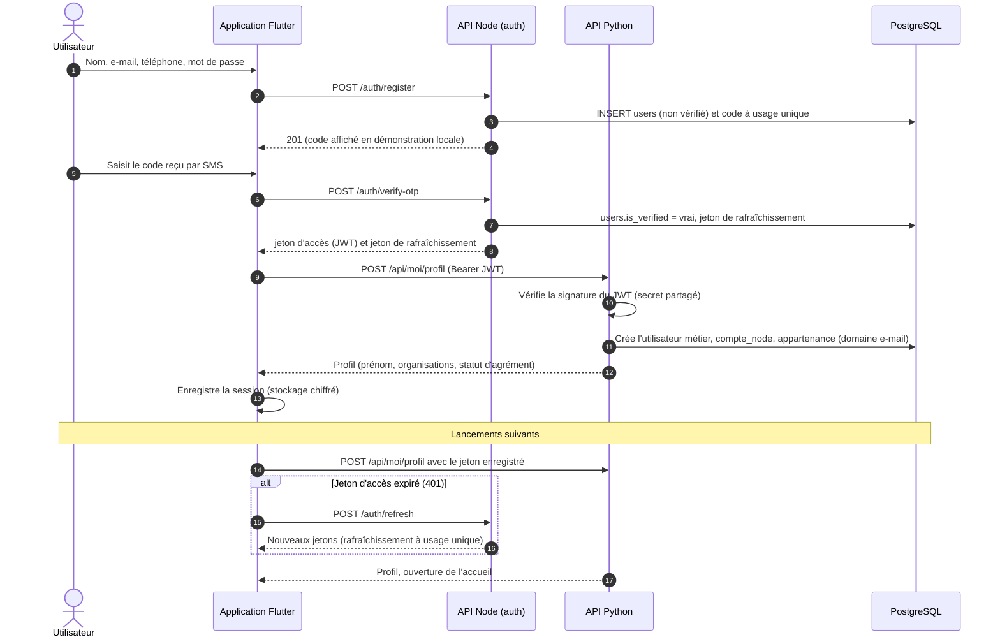

### 3.2 Demande de trajet et calcul des offres (prix détaillé)

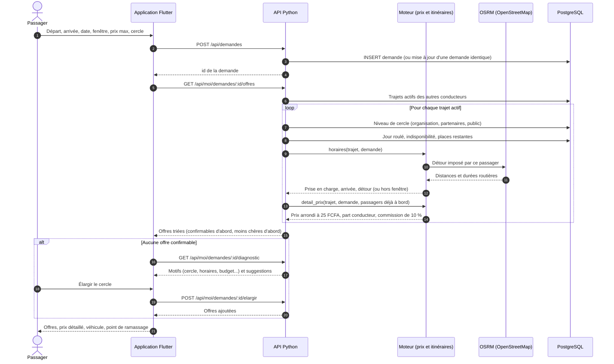

### 3.3 Négociation multi-agents (protocole Contract Net, FIPA-ACL)

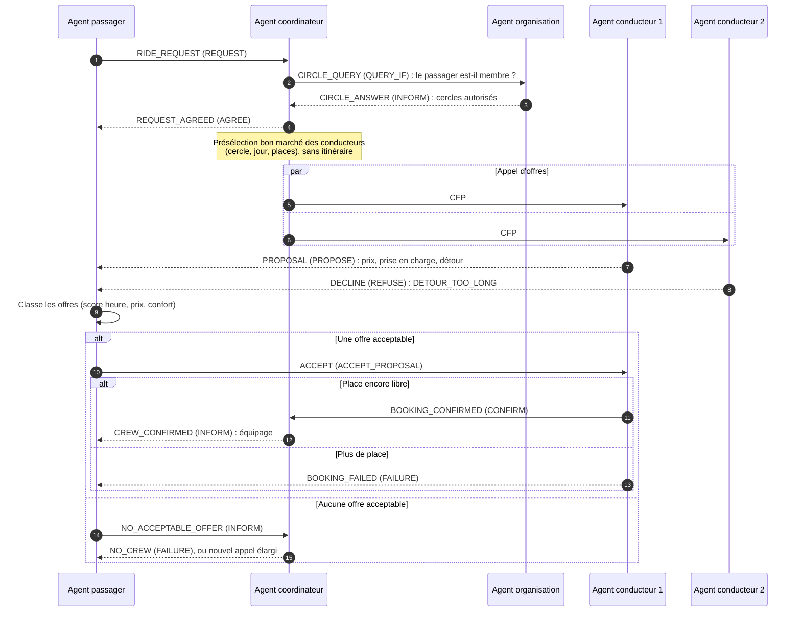

### 3.4 Réservation et paiement (portefeuille ou Mobile Money simulé)

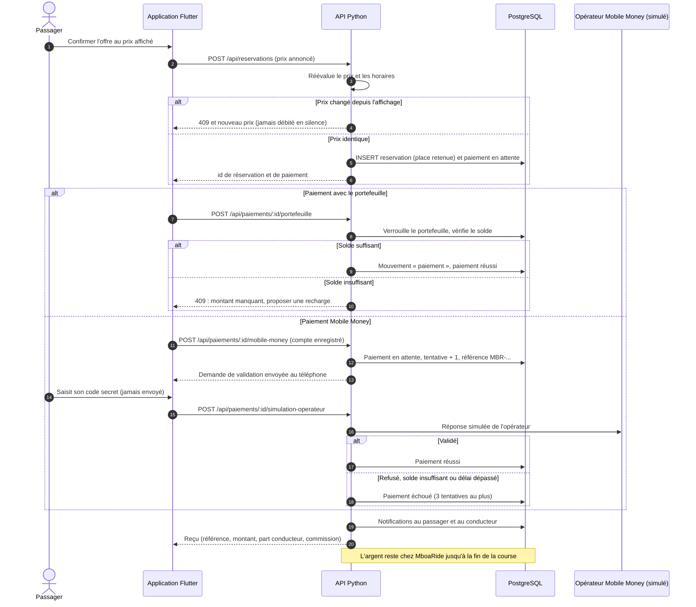

### 3.5 Course, fin de course et versement au conducteur

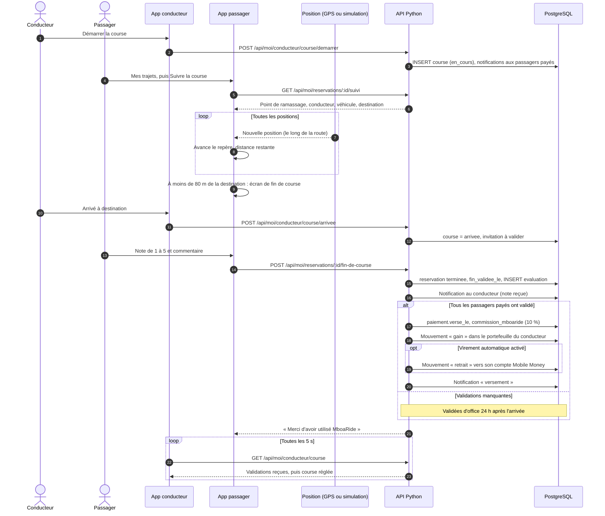

### 3.6 Retard ou annulation, et notifications

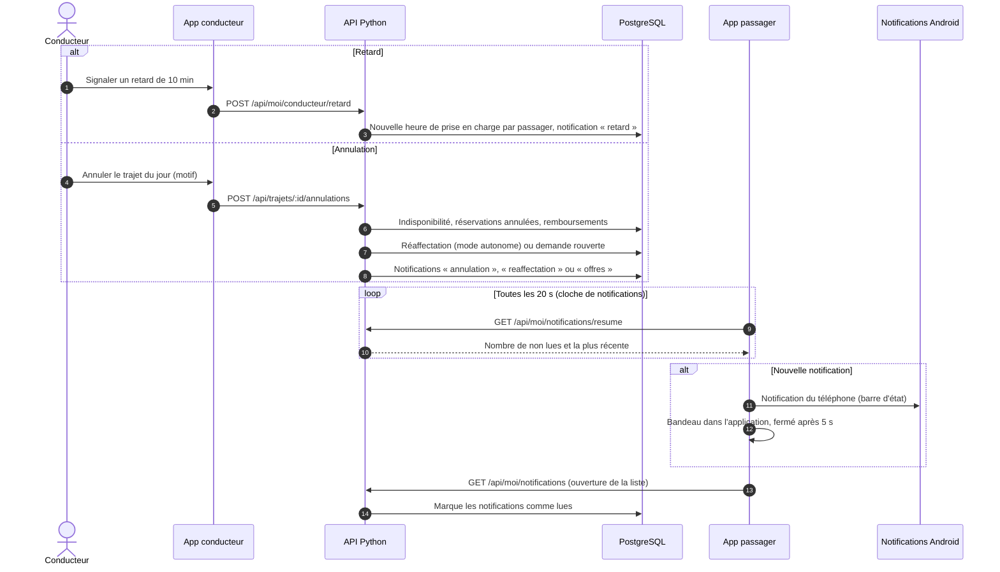

---

## 4. Diagrammes de classes

### 4.1 Domaine métier

Les classes persistantes (tables de la base) et les opérations exposées par l'API.
Conducteur et passager sont deux rôles d'un même `Utilisateur` : un passager devient
conducteur quand son agrément est actif.

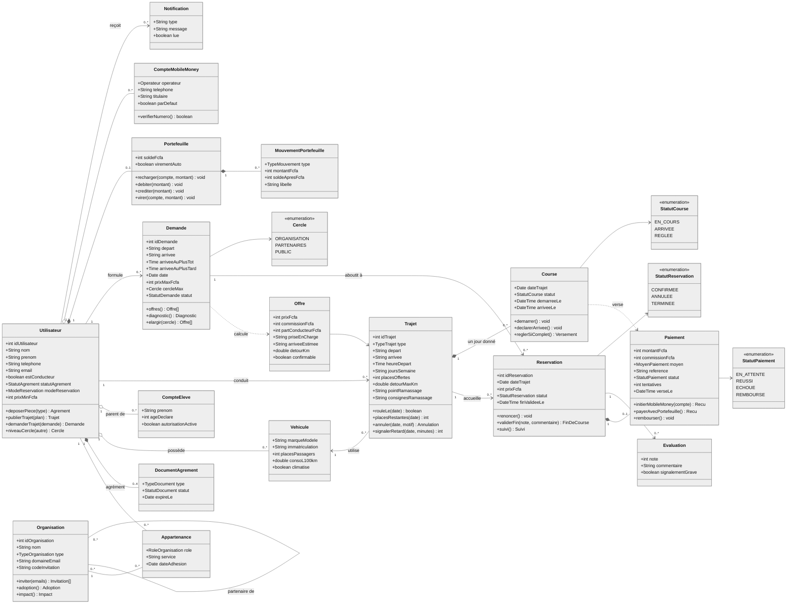

### 4.2 Moteur multi-agents et calcul du prix

Classes du paquet `agents/mboaride_agents`, réutilisées par l'API Python (`app/moteur.py`)
pour que le prix affiché soit celui que négocient les agents.

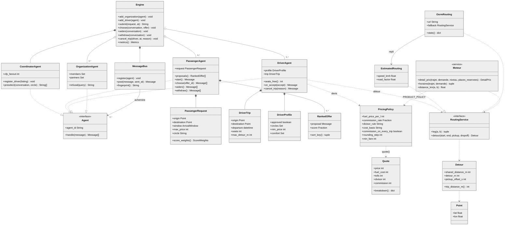

---

## 5. Diagrammes de cas d'utilisation

Ces trois diagrammes sont en **PlantUML** et non en Mermaid : Mermaid ne sait pas dessiner
les acteurs UML en bonhommes. PlantUML produit la notation complète, en noir et blanc :
acteurs en bonhommes, cas d'utilisation en ovales dans le cadre du système, relations
« include » et « extend » en flèches pointillées, généralisation entre acteurs.

Pour les afficher, coller le bloc (de `@startuml` à `@enduml`) sur
https://www.planttext.com, ou ouvrir ce fichier dans VS Code avec l'extension
« PlantUML » (Alt+D sur le bloc).

### 5.1 Passager (et parent d'élève)

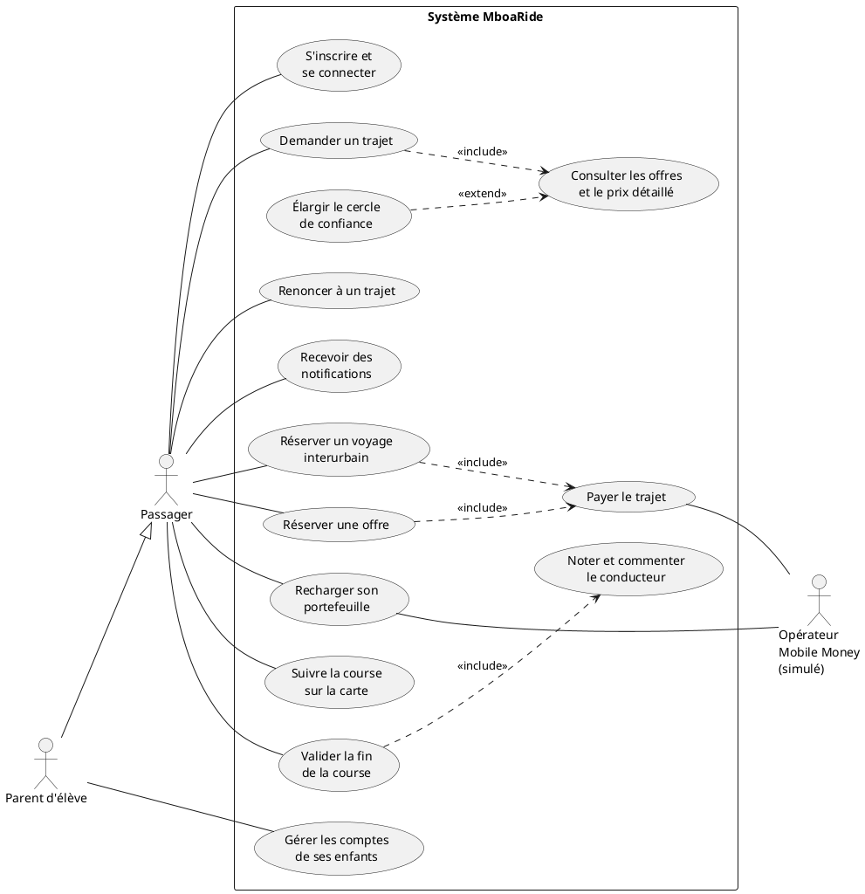

### 5.2 Conducteur

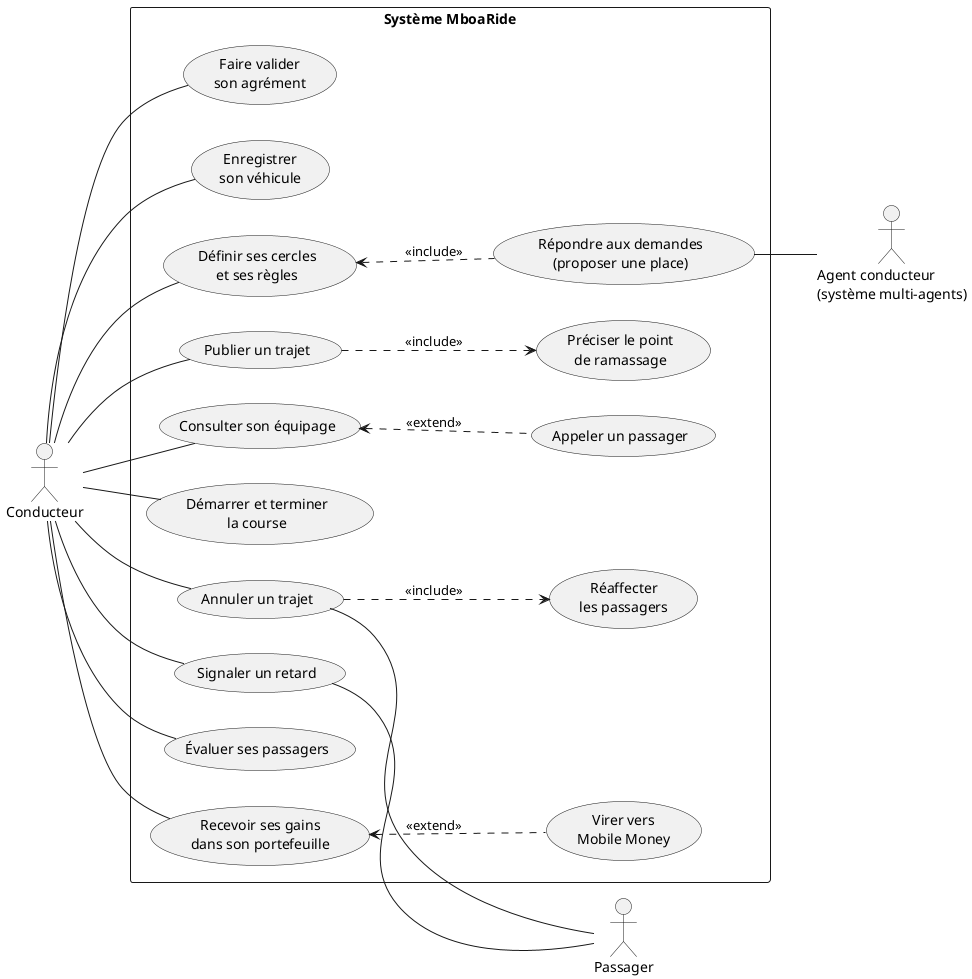

### 5.3 Organisation et console web

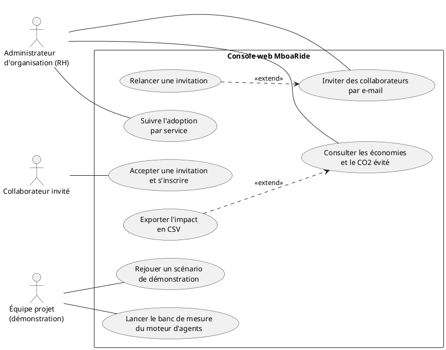
